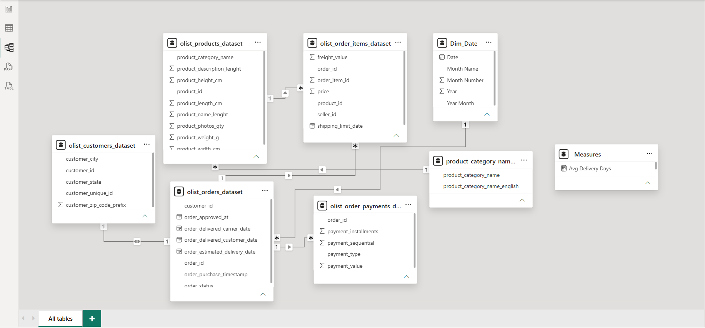

# Olist E-Commerce Business Performance Dashboard

## 📌 Project Overview
This project provides an end-to-end business intelligence solution for Olist, a Brazilian e-commerce platform. The dashboard tracks core financial KPIs, operational efficiency, and regional market dominance to give stakeholders a clear view of business health between 2016 and 2018.

**Objective:** Transform raw, unformatted relational datasets into an interactive, executive-ready dashboard that answers critical business questions regarding revenue trajectory, shipping logistics, and category performance.

---

## 📊 Dashboard Preview
![Olist E-Commerce Dashboard]

*(📄 [Click here to view the high-resolution PDF version](Olist%20E%20Commerce%20Performance%20dashboard.pdf))*

---

## 🛠️ Tech Stack & Data Architecture
* **Tool:** Power BI Desktop
* **Data Transformation (Power Query):** Promoted headers, standardized data types, and filtered out undefined data anomalies.
* **Data Modeling:** Designed a Star Schema connecting dimension tables (Customers, Products, Payments, Category Translation) to central fact tables (Orders, Order Items).
* **Date Dimension:** Engineered a custom `Dim_Date` table using DAX (`CALENDAR`, `ADDCOLUMNS`, `FORMAT`) to enable accurate time-intelligence reporting and chronological trend analysis.
* **DAX Measures:** Authored explicit measures for core KPIs:
  * `Total Revenue = SUM(olist_order_items_dataset[price])`
  * `Customer Orders = DISTINCTCOUNT(olist_order_items_dataset[order_id])`
  * `Total Products = DISTINCTCOUNT(olist_order_items_dataset[product_id])`
  * `Avg Delivery Days = AVERAGEX(olist_orders_dataset, DATEDIFF(olist_orders_dataset[order_purchase_timestamp], olist_orders_dataset[order_delivered_customer_date], DAY))`

### Data Model (Star Schema)

---

## 📈 Key Dashboard Features
1. **Executive KPIs:** High-level summary cards tracking Total Revenue ($13.6M), Customer Orders (99K), Total Products (33K), and Avg Delivery Days (12.5).
2. **Revenue Trajectory:** Chronological area chart mapping monthly revenue growth from 2016 to 2018.
3. **Geographic Concentration:** Top-N filtered column chart highlighting the top 5 Brazilian states by order volume.
4. **Operational Health:** Daily delivery timeline plotted against a 12-day corporate target line to monitor logistics efficiency.
5. **Category Value vs. Volume:** Dual-measure bar chart comparing `% Share of Revenue` against `% Share of Orders` across the top 7 product categories.
6. **Cash Flow Breakdown:** Payment method analysis by total transaction value.

---

## 💡 Core Business Insights
* **Market Dominance:** São Paulo (SP) is the primary engine of the business (~40K orders), vastly outpacing Rio de Janeiro (RJ) and Minas Gerais (MG).
* **Logistics Stabilization:** Early operations in late 2016 saw high volatility in delivery times (spiking near 60 days), which stabilized around the 12-day target across 2017 and 2018.
* **Category Value vs. Volume:** *Bed, Bath & Table* generates the highest share of order volume, whereas *Watches & Gifts* and *Health & Beauty* capture a disproportionately higher share of revenue—indicating higher average order values (AOV) in those segments.
* **Payment Preferences:** Credit cards dominate cash flow at over $12M in transaction value, followed by *Boleto* (Brazilian cash/voucher system).
